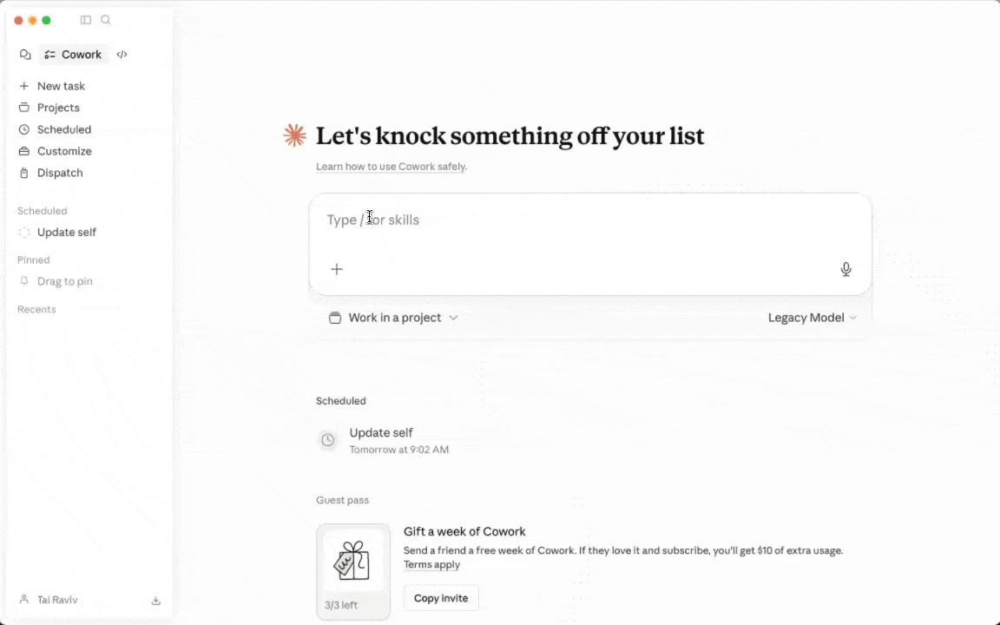

<p align="center">
   
</p>

<h1 align="center">Let AI watch you work</h1>

<h4 align="center">Familiar watches your screen so your AI can update its memory, skills, and knowledge.</h4>

<p align="center">
   <a href="https://looksfamiliar.org">https://looksfamiliar.org</a>
</p>

<p align="center">
  <a href="https://github.com/familiar-software/familiar/blob/main/LICENSE"></a>
</p>

---

We created Familiar to capture our screen (and clipboard) every 4 seconds and save it as markdown. That way our local agent can use that as context (through a cron, skill, or slash command).

## Use Familiar with your favorite agent

### Self-updating


### As a skill



## What people use Familiar for

- Fill the gap between AI tools: meeting transcribers, auto-memory layers, second brain
- Update Claude's skills/memory based on their workday (in a scheduled task/heartbeat)
- Typing "help me with what I'm working on right now" without having to prompt/describe what's going on their screen
- Enriching meeting transcripts with what was actually on screen (and vice versa)
- Forking it into their coaching app so coaches can see what learners did between sessions
- Someone new to tech used Familiar during a trial week at a YC startup, so that AI could coach him every few hours (and got the job)

## How agents use the output

Early users often report AI using Familiar's context as "connective tissue" or a "routing layer" to help agents map between resources. Recently, my agent "saw" that I spent a long time on a document, so it fetched the full doc directly. We've also seen the agent traverse the markdown, then decide to fetch the original image (so cool).

## The Bitter Lesson comes to our screens

We stand on the shoulders of giants: screenpipe, rewind, dayflow, etc. Since then: 1) Local agents got good at handling massive amounts of messy text files 2) Local agents have their own memory and skills systems.

Familiar is our "bitter lesson" version: just hand over context and get out of the way. The right way to do that piece is open source / free / offline.

## Privacy

Familiar uses Apple's native OCR, deletes screenshot images after 48 hours, and redacts passwords/credit card numbers/SSNs/API tokens/etc. We'd love contributions on what else to block: https://github.com/familiar-software/familiar/tree/main/src/ or in general ways to improve privacy.


## Additional Details

- Settings: `~/.familiar/settings.json`
- Captured still images: `<contextFolderPath>/familiar/stills/`
- Extracted markdown for captured still images: `<contextFolderPath>/familiar/stills-markdown/`
- Clipboard text mirrors while recording: `<contextFolderPath>/familiar/stills-markdown/<sessionId>/<timestamp>.clipboard.txt`
- Before still markdown and clipboard text are written, Familiar runs `rg`-based redaction for password/API-key patterns. If the scanner fails twice, Familiar still saves the file and shows a one-time warning toast per recording session.
- Meeting recording is started and stopped from the tray menu. It streams transcript events from the
  local Apple SpeechTranscriber helper into
  `<contextFolderPath>/familiar/stills-markdown/<sessionId>/<timestamp>.transcript.md`. The
  markdown file keeps a live `In progress` block for partial text, then replaces it with final
  transcript lines. Each transcript line includes an elapsed `[HH:MM:SS]` timestamp.
- Every voice recording captures the selected microphone and Mac audio separately. If finalized Mac
  audio contains speech, Familiar treats it as an online meeting; otherwise it treats the microphone
  as a nearby conversation. FluidAudio adds anonymous `Speaker N` labels after recording stops.
- The Settings window includes an **Audio** tab with an optional
  `meetingRecordingShortcut` setting. The default is `null`; when set, the global shortcut toggles
  meeting recording using the same start/stop path as the tray menu.
- During meeting recording, Familiar uses Electron's `powerSaveBlocker` with
  `prevent-display-sleep` so an explicit recording session stays visibly active instead of silently
  stopping on idle.
- Local development uses `scripts/bin/familiar-speech-helper` directly. You can override it with
  `FAMILIAR_SPEECH_HELPER_PATH=/path/to/helper`. The helper speaks a JSON command protocol over
  stdin/stdout and returns streaming transcript payloads with Apple segment and word timestamp
  metadata for line breaks.
- `FAMILIAR_AUDIO_INPUT_DEVICE_NAME="BlackHole 2ch"` selects a named macOS input device for
  local meeting transcription without changing the default system input.
- Meeting transcription requires macOS 26 or newer, an available SpeechTranscriber runtime, a
  supported current locale, microphone access, Screen Recording access, a usable input device, and
  an installed Apple speech asset. Familiar asks macOS to install a supported missing asset during
  startup preparation. The tray action remains disabled while preparing and stays disabled with an
  unavailable reason if a requirement fails.
- Xcode 26 is required to build the Swift helper, but users do not need Xcode installed. Apple speech
  models are managed by macOS and are not bundled with Familiar. Familiar does bundle the validated
  21.6 MB FluidAudio diarization model set, so diarization does not download models at runtime.
  BlackHole is only a local test routing device and is not packaged.
- Microphone permission is separate from Screen Recording permission on macOS. A local development
  run may not prompt if the responsible process already has permission, but the packaged app declares
  both `NSMicrophoneUsageDescription` and `NSScreenCaptureUsageDescription` and should be verified in
  System Settings.

### Real Audio Transcription Smoke Test

This gated test starts the real Swift speech helper, sends `start_capture`, and reports child
process state if the helper exits or hangs before responding:

```bash
npm run build:speech-helper
FAMILIAR_REAL_AUDIO_STARTUP_TEST=1 node --test test/real-audio-transcriber.test.js
```

This gated test uses BlackHole to route generated macOS speech into the real local transcriber:

```bash
npm run build:speech-helper
FAMILIAR_REAL_AUDIO_TEST=1 node --test test/real-audio-transcriber.test.js
```

These tests are skipped by default because they require macOS 26, microphone permission, and an
installed Apple SpeechTranscriber asset. The BlackHole route additionally requires the BlackHole
2ch audio device.

## Build locally

```bash
git clone https://github.com/familiar-software/familiar.git
cd familiar
npm install
npm run dist:mac
```

`npm run dist:mac*` includes `npm run build:rg-bundle`, which prepares `scripts/bin/rg/*` and packages it into Electron resources at `resources/rg/`.

The distribution scripts also rebuild the React dashboard, download and checksum the pinned
FluidAudio model bundle when it is not already cached, and build a universal speech helper before
packaging. Release builds therefore require Xcode 26 and network access to GitHub, Electron, and
Hugging Face; installed users do not.

`build-rg-bundle.sh` downloads official ripgrep binaries when missing (or copies from `FAMILIAR_RG_DARWIN_ARM64_SOURCE` / `FAMILIAR_RG_DARWIN_X64_SOURCE` if provided). The binaries are generated locally and are not committed.
